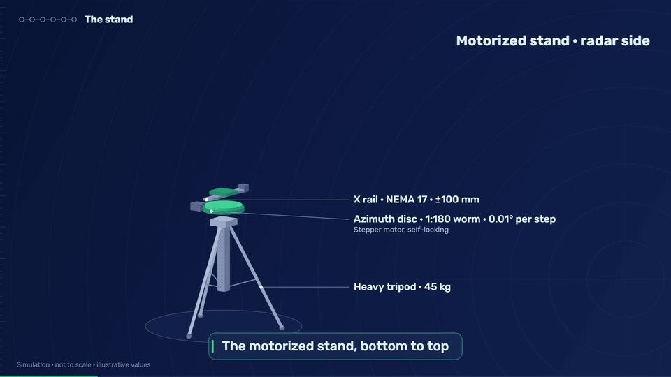

# coded-video

**Coded, not generated.** Short explainer and demo videos that your AI assistant writes as code and renders to MP4.

coded-video is an [Agent Skill](https://agentskills.io/specification) and Claude Code plugin. Your assistant first writes a scene-by-scene brief. Once you say go, it builds the animation as HTML, CSS, SVG and JavaScript (or real, lit 3D with the bundled Three.js), then renders it frame by frame into an MP4.

<!-- SHOWCASE -->
### Showcase

**A 15-second 3D product tutorial**, made by a fresh Claude Opus session from one phone photo of a supermarket shelf: brief first, then lit 3D (three.js), camera moves, pinned fact cards and step captions. The brand is made up for this demo.


**Engineering diagrams in motion**: a few seconds from a longer coded explainer, showing what the skill can draw: isometric 3D parts that assemble themselves, labelled callouts, camera cones sweeping a scene, laser beams and live readouts that update every frame.



**The two starters** that ship with the skill, rendered as they are:

| 3D starter (`template-3d.html`) | 2D starter (`template.html`) |
| --- | --- |
|  |  |

No image or video model is involved. Every shape, number and word on screen is exactly what's in the source file, so you can read it, fix a typo and render again.

## What it's for
- Product and feature demos
- Technical explainers and process walkthroughs
- Animated diagrams and data stories
- Title cards, logo reveals, intros and outros
- Short 2D, isometric and 3D animations for decks, READMEs and social posts
- 3D product shots: packaging, devices and mechanisms, with real lighting and soft shadows

## What it's not for
Realistic people, faces, places or camera-style footage. For that you need a generative video tool. coded-video makes clean motion graphics: precise, editable and repeatable, but drawn, not filmed.

## Install as a Claude Code plugin

In Claude Code, run:

```
/plugin install coded-video --marketplace necromancer124/coded-video
```

On Claude Code older than 2.1.275, use two steps instead:

```
/plugin marketplace add necromancer124/coded-video
/plugin install coded-video@coded-video
```

Then start a new session. The skill loads as `coded-video:coded-video`, and Claude picks it up on its own when you ask for an explainer, a demo video or an animation.

**Other assistants:** copy `skills/coded-video/` into your client's skills folder (for example `.claude/skills/` or `.agents/skills/`), or point the assistant at `skills/coded-video/SKILL.md`. It needs file and shell tools to build and render.

## Requirements for rendering
- Python 3.10+
- Playwright with a browser:
  ```sh
  python -m pip install playwright
  python -m playwright install chromium
  ```
  Or use an installed Chrome or Edge with `--browser chrome` or `--browser msedge`.
- ffmpeg on PATH: `winget install Gyan.FFmpeg`, `brew install ffmpeg` or `sudo apt install ffmpeg`.

Nothing is installed automatically.

## How it works
1. **Brief.** You describe the video. The assistant writes `brief.md`: goal, length, style, and a numbered scene list with exact times, on-screen text and motion. Then it **stops and waits for your go**.
2. **Build.** After your go, it writes one HTML page that defines `window.VIDEO` (size, fps, length) and `window.renderAt(t)`, a function that draws the frame at time `t`. Open the page in a browser to preview and scrub it.
3. **Render.** `render.py` draws every frame at its exact time, captures it with a headless browser and pipes it to ffmpeg.
4. **Check.** It grabs stills from each scene and inspects them before calling the video done.

Try the included 5-second starters, one 2D and one 3D:

```sh
python skills/coded-video/scripts/render.py skills/coded-video/assets/template.html --output output/starter.mp4
python skills/coded-video/scripts/render.py skills/coded-video/assets/template-3d.html --output output/starter-3d.mp4 --sheet output/starter-3d-sheet.png
```

Useful flags: `--sheet sheet.png` for a one-frame-per-second contact sheet, `--stills 1.5,4.9` for single frames, `--scale 0.5` for a half-size draft, `--start`/`--end` to render one section, `--fps` to override the page, `--audio track.mp3` to add a soundtrack, `--gl swiftshader` for software-only 3D that looks the same on any machine (the default uses the GPU and is 3–4× faster). The script prints the frame count, duration and size measured from the finished file.

The renderer serves the page's own folder on a private local address and blocks every other host unless you pass `--allow-network`, so bundle fonts, images and models locally. **Render trusted HTML only:** blocking the network is not a sandbox.

## Is it "AI-generated"?
It's made by an AI assistant writing code. It's not synthetic footage: no model invents pixels, and the renderer adds no watermark. If you publish it, check the disclosure rules of the platform you post on. They differ by platform and change over time.

## Check the package

```sh
python -m pip install -r requirements-dev.txt
python -m playwright install chromium
python -m unittest discover -s tests -v
```

The tests check the skill metadata, the plugin manifests and a real render: frame count, size, duration, and that the same time always gives the same frame.

## License
MIT. See [LICENSE](LICENSE). Bundled three.js 0.187.0 is MIT-licensed by the three.js authors; see `skills/coded-video/assets/vendor/three/LICENSE`.
